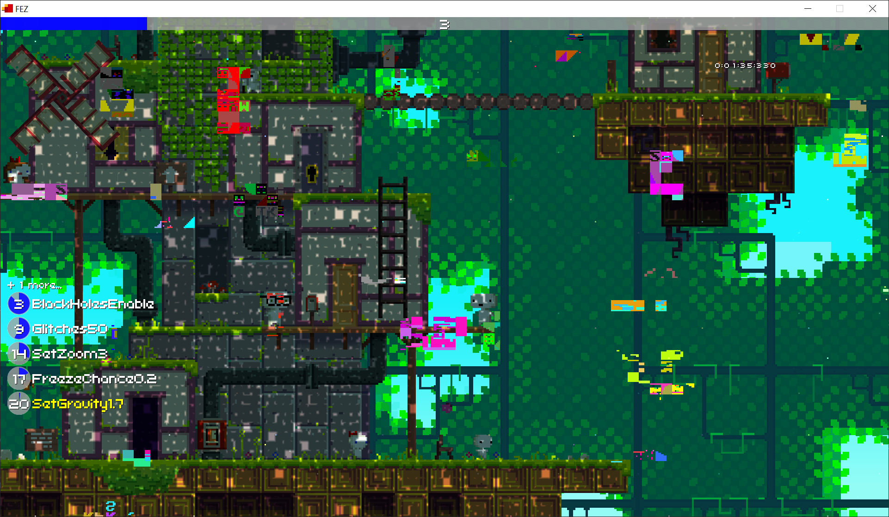

# FezChaosMod

Game modification for FEZ adding random effects 

## Overview 

This library is a game modification for the video game FEZ which adds a chaos mod (game modification that activate a random effect every so many seconds).

Please support me on Patreon: https://www.patreon.com/jenna1337 

## Features

For a full list of features, see [changelog.txt](/changelog.txt)

## Installation

> __Note__: the .NET 10 build uses IMGUI for settings and progress indicators and does not require System.Drawing.Common or WinForms.

### Method 1: HAT

1. Install [HAT](https://github.com/Krzyhau/HAT) via the instructions there
2. Download FezChaosMod.zip from https://github.com/Jenna1337/FezChaosMod/releases/latest and put it in the "Mods" directory.
3. Run `MONOMODDED_FEZ.exe` and enjoy!

### Method 2 (deprecated): MonoMod

1. Download [MonoMod](https://github.com/MonoMod/MonoMod/releases) and unpack it in the game's directory.
2. Download FEZ.ChaosMod.mm.dll from https://github.com/Jenna1337/FezChaosMod/releases/latest and put it in the game's directory.
3. Run command `MonoMod.exe FEZ.exe` (or drag `FEZ.exe` onto `MonoMod.exe`). This should generate new executable file called `MONOMODDED_FEZ.exe`.
4. Run `MONOMODDED_FEZ.exe` and enjoy!

## Building

### .NET 10 / HAT

1. Install the .NET 10 SDK and a compatible FEZ installation with HAT and IMGUI.
2. Copy `UserProperties.xml.template` to `UserProperties.xml` and configure `FezDir`, `MonoModDir`, `ImGuiDir`, and `ModOutputDir`.
3. Run `dotnet build FezChaosMod-NET10.slnx --configuration Release`. The build copies the mod DLL, symbols, and metadata to `ModOutputDir`.

Settings windows and progress indicators use the IMGUI mod's renderer. Remaining game text and textures use FNA; the .NET 10 build excludes the legacy GDI+ progress renderers and WinForms resources.

### Legacy MonoMod

1. Clone repository.
2. Copy all dependencies listed in `libs` directory and paste them into said directory.
3. Build it. idk. it should work.

## Contributing

Look for comments starting with the text `TODO` (whole word, case sensitive) (e.g., `//TODO add effects that mess with the controls`)

